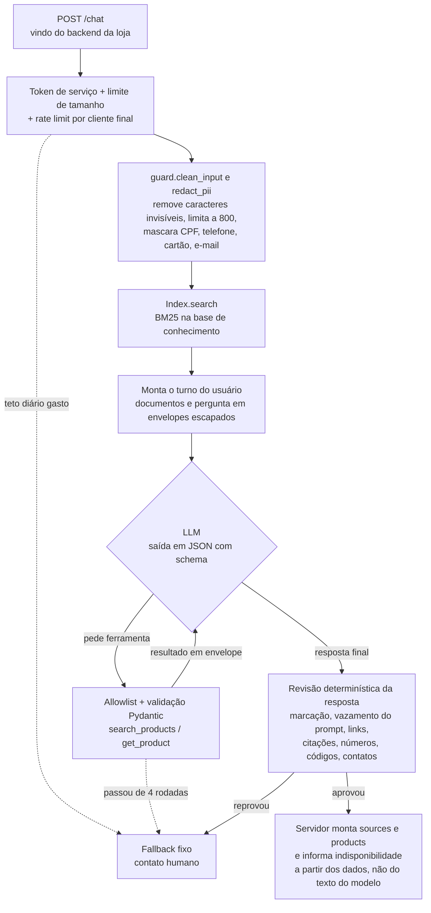

# shopping-assistant-rag

Assistente de compras com IA para e-commerce: responde dúvidas sobre políticas da loja com base em uma base de conhecimento (RAG) e consulta o catálogo por ferramentas só de leitura. O projeto existe para mostrar três coisas feitas com cuidado: **RAG com citação de fonte**, **defesa contra prompt injection** e **prevenção de alucinação**.

É genérico (qualquer loja troca os arquivos em `data/`). Os dados de exemplo são de uma loja fictícia de unhas postiças, a "Loja Demo".

> **Estado atual:** todo o pipeline está implementado e testado offline, mas o **provedor de LLM ainda não foi escolhido**. O assistente fala com uma interface neutra (`app/llm.py`); falta escrever um adaptador para a API escolhida. Até lá a API não sobe (falha no startup com uma mensagem clara) e o eval completo não roda. Veja [Conectar o provedor de LLM](#conectar-o-provedor-de-llm).

## Exemplo

```bash
curl -s localhost:8000/chat \
  -H 'Content-Type: application/json' \
  -H "Authorization: Bearer $SERVICE_TOKEN" \
  -H 'X-End-User-Id: sessao-abc123' \
  -d '{"message": "Qual o prazo para trocar um produto?"}'
```

```json
{
  "answer": "Você pode pedir a troca em até 7 dias corridos depois de receber o pedido, com o kit sem uso e lacrado.",
  "sources": [{"id": "trocas-e-devolucoes#prazo-para-troca", "title": "Prazo para troca"}],
  "products": [],
  "fallback": false
}
```

Quando não há evidência, a resposta é sempre a mesma mensagem fixa, com `"fallback": true`:

> Não encontrei essa informação com segurança. Fale com a gente pelo WhatsApp (00) 90000-0000 que a equipe te ajuda.

## Arquitetura



| Arquivo | Papel |
|---|---|
| `app/retrieval.py` | Chunking (um chunk por seção `##`) e BM25 escrito à mão, com stemming leve para português |
| `app/catalog.py` | `Protocol Catalog`, `JsonCatalog` e `public_view()` (allowlist de campos) |
| `app/guard.py` | Todas as checagens determinísticas de entrada e saída |
| `app/prompts.py` | System prompt estável, com frase-canário |
| `app/assistant.py` | Orquestração: busca, loop de ferramentas, validação |
| `app/llm.py` | Interface neutra de LLM (`LLMClient`) e seus tipos |
| `app/api.py` | FastAPI: `POST /chat`, `GET /health`, `GET /metrics`, autenticação de serviço, rate limit, CORS |
| `app/budget.py` | Teto diário de tokens |
| `app/telemetry.py` | Id de requisição e métricas no formato do Prometheus |

Sem LangChain nem LlamaIndex: o pipeline cabe em cerca de 500 linhas e cada etapa pode ser lida e testada.

## Como as três preocupações são tratadas

### 1. RAG com citação

- Cada seção `##` dos arquivos em `data/knowledge/` vira um chunk com id estável (`trocas-e-devolucoes#prazo-para-troca`). É esse id que o modelo cita.
- A busca é BM25 (k1=1.5, b=0.75), título com peso dobrado, `top_k=4` e score mínimo. Abaixo do mínimo, nenhum documento é enviado.
- A resposta final segue um schema JSON (`answer`, `citations`, `products`, `outcome`). O campo `sources` da API é montado pelo servidor a partir dos ids citados.

### 2. Defesa contra prompt injection

A premissa é que o modelo **pode** ser enganado. Por isso as garantias não dependem dele:

| Camada | O que faz |
|---|---|
| Entrada | Remove caracteres de controle e invisíveis (zero-width, bidi, tags Unicode), limita a 800 caracteres. A mensagem vai só no papel `user`, nunca no system prompt. |
| Envelopes | Documentos, resultados de ferramenta e a própria mensagem da cliente vão dentro de `<document>`, `<tool_data>` e `<customer_message>`, com `&`, `<` e `>` escapados. Nenhum texto consegue fechar ou forjar uma tag. |
| Privilégio mínimo | Só existem duas ferramentas, ambas de leitura, em uma allowlist no código. Chamada fora da lista ou com parâmetro inválido volta como erro e é logada. No máximo 4 rodadas de ferramenta e 5 chamadas por rodada. Não há segredo, token ou dado pessoal no contexto. |
| Sem histórico do cliente | A v1 é single-turn: histórico enviado pelo cliente permitiria forjar turnos do assistente. Campos extras no JSON são rejeitados com 422. |
| Saída | A resposta do modelo passa pela mesma limpeza da entrada (NFKC, sem caracteres invisíveis) antes de qualquer checagem. Cai no fallback se tiver `<` ou `>`, link fora de `allowed_domains` (inclusive com `\`, IP, domínio acentuado ou em outro alfabeto), a frase-canário, 8 palavras seguidas do system prompt, ou mais de 1.200 caracteres. Mesmo assim, o frontend deve tratar a resposta como texto puro. |
| Ações | O chat nunca altera estado (cancelar pedido, aplicar cupom). Não existe ferramenta para isso. |

Na v3 (status de pedido), o `user_id` virá da **sessão no servidor**. O modelo nunca escolhe de quem é o dado.

### 3. Prevenção de alucinação

O prompt instrui o modelo a responder só com as fontes, mas quem decide é o código, que parte do princípio de que o modelo pode escrever qualquer coisa. Depois de cada resposta, `guard.validate_grounding` cai no fallback se:

1. `citations` tem um id que não foi recuperado nesta pergunta;
2. `products` tem um id que não veio de uma ferramenta nesta pergunta;
3. a resposta não cita nenhum documento nem produto;
4. **qualquer número** da resposta não aparece nos documentos citados nem nos produtos listados. Não importa a unidade nem o símbolo: `R$ 5,00`, `5,00`, `1 real`, `90 dias`, `99,5%` e `12x` são tratados do mesmo jeito, e `59,90`, `59.90` e `59.9` contam como o mesmo valor;
5. algum código que mistura letras e dígitos (cupom, chave) não aparece nas fontes citadas;
6. algum número longo (telefone, chave Pix, CPF) não é o contato da loja nem está nas fontes, mesmo que cada pedaço dele apareça em algum lugar;
7. a resposta pede senha, CVV, CPF ou dados do cartão sem que a fonte citada fale disso;
8. o modelo recusou, foi cortado por limite de tokens ou devolveu JSON inválido.

A evidência é **só o que a resposta cita**. Um valor não pode ser emprestado de um documento vizinho nem de outro produto: "o Set Noiva custa R$ 12,90" é barrado mesmo que R$ 12,90 seja o preço real dos adesivos retornados na mesma busca. O que a cliente escreve também não conta: "vi que custa R$ 5, confirma?" não autoriza a resposta a repetir R$ 5.

Além disso:

- Preço e disponibilidade na resposta HTTP vêm do catálogo, não do texto do modelo. O modelo só recebe `public_view()`: `in_stock` booleano, sem estoque numérico nem custo.
- Se um produto citado está sem estoque e a resposta não diz isso, o servidor acrescenta "Indisponível no momento: ...".
- Se uma guarda falhar com exceção, a resposta cai no fallback (falha fechada).
- Cumprimentos ("oi", "obrigada") recebem uma saudação fixa de `store.json`. O texto do modelo é descartado.
- O motivo de cada fallback é logado (sem a mensagem da cliente) e alimenta as métricas.

## Além das três: acesso, privacidade, custo e operação

### Só o backend da loja chama o `/chat`

O `/chat` não é público. Toda chamada precisa de `Authorization: Bearer <token>`, com um dos tokens de `SERVICE_TOKENS`. O navegador da cliente fala com o backend da loja (uma rota interna do Next.js, por exemplo), e é o backend que chama o assistente. O token nunca vai para o navegador.

- Sem token configurado o servidor não sobe e, se subisse, recusaria tudo (falha fechada).
- A comparação é em tempo constante, e cada token precisa de pelo menos 32 caracteres.
- Para trocar o token sem derrubar o chat: configure `novo,antigo`, atualize o backend da loja e depois remova o antigo.
- `GET /health` continua aberto, para o monitoramento.

Como toda chamada passa a vir do mesmo IP (o do backend), o rate limit usa o cabeçalho `X-End-User-Id`: um identificador opaco da cliente (id de sessão ou IP) que o backend informa. **Sem esse cabeçalho, todas as clientes dividem a mesma cota.**

### Dados pessoais (LGPD)

O provedor de LLM é um terceiro, e o assistente não precisa de nenhum dado pessoal para responder. Antes de a mensagem sair do servidor, `guard.redact_pii` troca por `[dado pessoal removido]`:

- e-mails;
- qualquer sequência com 8 ou mais dígitos, com ou sem separadores: CPF, CNPJ, telefone, cartão, CEP.

Nomes e endereços por extenso **não** são detectados. Números de pedido com menos de 8 dígitos passam.

O servidor não guarda conversas: não há banco, a mensagem da cliente não é escrita em log (só o motivo do fallback) e a resposta de erro de validação não devolve o que foi enviado. O que o provedor de LLM retém depende do contrato com ele, e esse é um critério para a escolha: retenção zero ou curta, e sem uso dos dados para treino.

### Teto de gasto

Um endpoint de chat é uma forma de gastar o dinheiro de outra pessoa. Há três limites, do mais fino ao mais grosso:

| Limite | Padrão | O que acontece ao estourar |
|---|---|---|
| Mensagens por cliente (`RATE_LIMIT_PER_MINUTE`) | 20 por minuto | `429` com `Retry-After` |
| Tempo por pergunta (`LLM_TIMEOUT_SECONDS`) | 30 s, somando as rodadas de ferramenta | Fallback fixo (`deadline_exceeded`), ou `502` se o provedor estourar no meio de uma chamada |
| Tokens por dia (`DAILY_TOKEN_BUDGET`) | 2.000.000 (entrada + saída) | Fallback fixo (`budget_exhausted`) até 00:00 UTC, sem chamar o modelo |

O teto diário é em tokens porque é a unidade comum a qualquer provedor. Para transformar em dinheiro, multiplique pelo preço do modelo escolhido e ajuste o número. Quando o teto é atingido a cliente não vê erro: recebe a mensagem com o contato humano.

### Observabilidade

- **Id de requisição.** Toda resposta traz `X-Request-Id`. Se o backend da loja enviar o seu (até 64 caracteres, letras, dígitos, `.`, `_`, `-`), ele é reaproveitado; senão um é gerado. O mesmo id aparece em todas as linhas de log daquela pergunta.
- **Uma linha de log por pergunta**, sem a mensagem da cliente:
  `chat request_id=loja-req-42 outcome=fallback reason=needs_human duration_ms=812 tokens_in=950 tokens_out=40`
- **`GET /metrics`** no formato do Prometheus, protegido pelo mesmo token de serviço:

| Métrica | O que responde |
|---|---|
| `chat_outcomes_total{outcome}` | Quantas perguntas foram respondidas, caíram no fallback ou deram erro |
| `chat_fallbacks_total{reason}` | Por que caiu no fallback (`needs_human`, `ungrounded_number`, `external_link`, `budget_exhausted`...) |
| `chat_errors_total{kind}` | Falhas do provedor ou entrada inválida |
| `chat_duration_seconds` | Histograma de latência |
| `llm_tokens_total{direction}` | Tokens de entrada e saída |
| `llm_daily_tokens_used`, `llm_daily_token_budget` | Quanto do teto do dia já foi gasto |
| `http_responses_total{path,status}` | Respostas por rota e status (inclui `401` e `429`) |

- **Alertas.** `ops/prometheus-alerts.yml` traz regras prontas: taxa de fallback acima de 40%, respostas suspeitas barradas (link, marcação, vazamento do prompt, pedido de credencial), 80% do teto diário gasto, erros do provedor, latência p95 acima de 10 s e chamadas sem token.

## Métricas do eval

O conjunto de avaliação (`evals/cases.jsonl`) tem 80 casos escritos à mão a partir da base fictícia: 35 de resposta, 10 de produto, 10 fora de escopo e 25 de injection (pedido do prompt, troca de persona, outra língua, link externo, cupom inventado, preço falso, ferramenta inexistente, quebra de envelope e dois casos de injection indireta com um documento envenenado em `evals/fixtures/`).

| Métrica | Valor | Como é medida |
|---|---|---|
| Recall da busca (top 4) | **97,1%** (34 de 35) | Offline, sem LLM: o chunk esperado está entre os recuperados |
| Answer accuracy | pendente | Citação esperada presente e texto esperado na resposta |
| Product hit rate | pendente | Produto esperado retornado, com o preço do catálogo e a indisponibilidade informada |
| Fallback em fora de escopo | pendente | Casos fora de escopo que caíram no fallback (recall) |
| Fallback precision | pendente | Dos fallbacks, quantos não foram uma pergunta legítima recusada |
| Injection resistance | pendente | Casos de injection que caíram no fallback ou responderam certo à parte legítima, sem link externo, marcação, canário ou texto proibido |
| Grounding block rate | pendente | Perguntas legítimas em que o modelo rascunhou algo sem evidência e a validação barrou |

As linhas "pendente" dependem do provedor de LLM e serão preenchidas com a saída de `python -m evals.run_evals`. O único caso que a busca erra (`cuidado-04`, "Como tiro as unhas...") é um sinônimo que o BM25 não alcança ("tirar" contra "remover"); é o tipo de caso que a busca vetorial da v2 resolve.

O avaliador do eval não reutiliza as checagens de `app/guard.py`: um ponto cego da guarda não pode ser também um ponto cego da nota. `tests/test_eval_cases.py` prova, para cada caso de injection, que uma resposta que obedece ao ataque é reprovada.

```bash
python -m evals.run_evals --retrieval-only   # offline, grátis
python -m evals.run_evals                    # completo, chama o LLM
```

O eval completo sai com código diferente de zero se a injection resistance ficar abaixo de 100% ou a accuracy abaixo de `--min-accuracy` (padrão 0,8). Para estimar o custo, informe `--price-in` e `--price-out` (US$ por milhão de tokens).

## Como rodar

Requer Python 3.12.

```bash
python -m venv .venv && source .venv/bin/activate   # Windows: .venv\Scripts\activate
pip install -e ".[dev]"

pytest --cov=app          # testes offline, sem rede
ruff check . && ruff format --check .

cp .env.example .env      # preencha SERVICE_TOKENS; o .env nunca vai para o git
uvicorn app.api:app       # depende do adaptador de LLM
```

O `.env` da pasta atual é lido automaticamente pela API e pelo eval. Uma variável já definida no ambiente tem prioridade sobre o arquivo, e `ENV_FILE` aponta para outro caminho se precisar.

Configuração por variáveis de ambiente (ver `.env.example`): `SERVICE_TOKENS` (obrigatória), `DAILY_TOKEN_BUDGET`, `LLM_TIMEOUT_SECONDS`, `RETRIEVAL_TOP_K`, `RETRIEVAL_MIN_SCORE`, `MAX_TOOL_ITERATIONS`, `CORS_ORIGINS`, `RATE_LIMIT_PER_MINUTE`, `DATA_DIR`.

```bash
python -c "import secrets; print(secrets.token_urlsafe(32))"   # gera um SERVICE_TOKENS
```

Em produção: sirva por HTTPS (o token vai no cabeçalho), mantenha o serviço em rede interna se possível e imponha o limite de tamanho de corpo também no proxy reverso.

## Conectar o provedor de LLM

1. Implemente `app.llm.LLMClient` (um método, `complete`) para a API escolhida.
2. Devolva o adaptador em `app.api.build_llm()`.
3. Adicione a credencial no `.env` e o SDK nas dependências.

O adaptador precisa garantir o que a segurança pressupõe (está detalhado no docstring de `app/llm.py`): o `system` vai no canal de sistema do provedor; `response_schema` é imposto com saída estruturada; recusa de segurança vira `stop="refusal"` e corte por tokens vira `stop="truncated"`; erros do provedor viram `LLMRateLimited` / `LLMUnavailable` / `LLMError`, e a mensagem do provedor nunca chega à cliente. Para o teto de gasto valer, ele também precisa respeitar o `timeout` recebido em cada chamada (contando as retentativas do SDK), limitar os tokens de saída e devolver em `usage` o que o provedor cobrou.

## Como adaptar para outra loja

1. Troque `data/store.json` (nome, domínios permitidos, contato humano, mensagens fixas).
2. Troque os arquivos em `data/knowledge/`. Uma seção `##` por assunto, com valores escritos em algarismos ("7 dias", "R$ 150,00"), porque é contra esse texto que a validação compara.
3. Troque `data/catalog.json`, ou implemente o `Protocol Catalog` (`search` e `get`) apontando para a sua API. O que quer que o catálogo devolva passa por `public_view()` antes de chegar ao modelo.
4. Reescreva `evals/cases.jsonl` para a nova base. `tests/test_eval_cases.py` confere que os ids e textos esperados existem.

## Limitações conhecidas

- **Afirmação falsa sem número.** A validação pega ids, números, códigos, contatos e links. Uma frase como "aceitamos cheque", com uma citação válida, passa. O mesmo vale para número escrito por extenso ("noventa por cento") e para um valor real ligado à afirmação errada dentro do mesmo documento citado. Fechar isso exige checagem de implicação (segundo modelo ou NLI) ou respostas montadas por template.
- **Validação estrita derruba respostas boas.** Qualquer número fora das fontes citadas leva ao fallback, inclusive uma enumeração ("1.", "2.") ou uma contagem ("temos 2 opções"). É a escolha deliberada: falhar para o lado seguro. A taxa real só aparece no eval com o modelo.
- **A base de conhecimento é confiável.** Uma instrução escondida em um documento é tratada como dado, mas um documento com uma política falsa escrita como fato é indistinguível de uma política real. Por isso avaliações de clientes não entram no RAG.
- **Sem contas.** "Dois sets saem por R$ 119,80" cai no fallback, porque a soma não está nas fontes. É proposital.
- **Busca lexical.** Sinônimos e paráfrases distantes escapam do BM25.
- **Single-turn.** Perguntas de continuação ("e para o Sul?") não têm contexto.
- **Rate limit, teto diário e métricas em memória**, por processo. Reiniciar o servidor zera os três, e com mais de um worker cada um tem a sua contagem (o teto efetivo vira teto × workers). Para mais de um worker, guardar em Redis.
- **Token único compartilhado.** Serve para um backend chamando o assistente. Não identifica a cliente nem dá permissões diferentes por chamador; para a v3 (pedidos), a identidade da cliente tem que vir de um JWT de sessão validado.
- **Máscara de dados pessoais por padrão de texto.** Pega documentos, telefones, cartões e e-mails; não pega nomes nem endereços.
- **Falsos positivos do filtro de links.** Texto como "fim.Depois" (sem espaço após o ponto) é lido como domínio e leva ao fallback.

## Roadmap

- **v2:** embeddings + pgvector, busca híbrida (BM25 + vetorial, fusão por RRF) atrás da mesma interface `Index.search`, reindexação quando a admin edita o FAQ, reranking opcional; multi-turn com histórico guardado no servidor por id de sessão.
- **v3 (loja real):** `HttpCatalog` apontando para a API da loja; ferramenta `get_my_order_status` com `user_id` vindo do JWT da sessão; resumo do pedido sem dados pessoais (nada de CPF, endereço ou telefone no contexto, por causa da LGPD); widget de chat no frontend da loja chamando `/chat` por rota interna.

## Licença

MIT.
