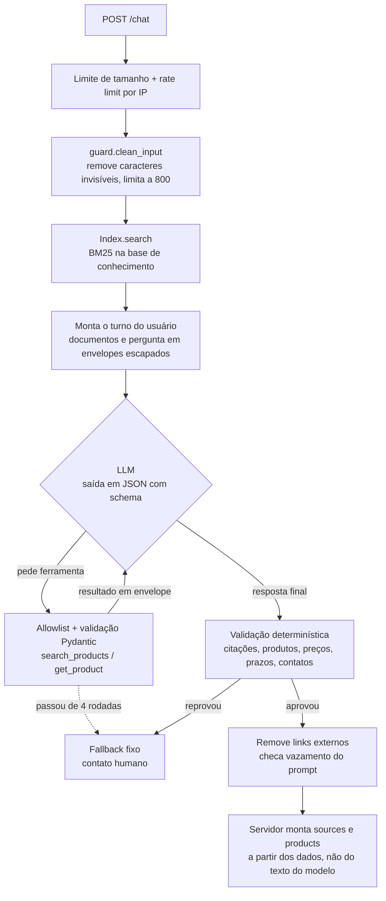

# shopping-assistant-rag

Assistente de compras com IA para e-commerce: responde dúvidas sobre políticas da loja com base em uma base de conhecimento (RAG) e consulta o catálogo por ferramentas só de leitura. O projeto existe para mostrar três coisas feitas com cuidado: **RAG com citação de fonte**, **defesa contra prompt injection** e **prevenção de alucinação**.

É genérico (qualquer loja troca os arquivos em `data/`). Os dados de exemplo são de uma loja fictícia de unhas postiças, a "Loja Demo".

> **Estado atual:** todo o pipeline está implementado e testado offline, mas o **provedor de LLM ainda não foi escolhido**. O assistente fala com uma interface neutra (`app/llm.py`); falta escrever um adaptador para a API escolhida. Até lá a API não sobe (falha no startup com uma mensagem clara) e o eval completo não roda. Veja [Conectar o provedor de LLM](#conectar-o-provedor-de-llm).

## Exemplo

```bash
curl -s localhost:8000/chat -H 'Content-Type: application/json' \
  -d '{"message": "Qual o prazo para trocar um produto?"}'
```

```json
{
  "answer": "Você pode pedir a troca em até 7 dias corridos depois de receber o pedido, com o kit sem uso e lacrado.",
  "sources": [{"id": "trocas-e-devolucoes#prazo-para-troca", "title": "Prazo para troca"}],
  "products": [],
  "fallback": false
}
```

Quando não há evidência, a resposta é sempre a mesma mensagem fixa, com `"fallback": true`:

> Não encontrei essa informação com segurança. Fale com a gente pelo WhatsApp (00) 90000-0000 que a equipe te ajuda.

## Arquitetura



| Arquivo | Papel |
|---|---|
| `app/retrieval.py` | Chunking (um chunk por seção `##`) e BM25 escrito à mão, com stemming leve para português |
| `app/catalog.py` | `Protocol Catalog`, `JsonCatalog` e `public_view()` (allowlist de campos) |
| `app/guard.py` | Todas as checagens determinísticas de entrada e saída |
| `app/prompts.py` | System prompt estável, com frase-canário |
| `app/assistant.py` | Orquestração: busca, loop de ferramentas, validação |
| `app/llm.py` | Interface neutra de LLM (`LLMClient`) e seus tipos |
| `app/api.py` | FastAPI: `POST /chat`, `GET /health`, rate limit, CORS |

Sem LangChain nem LlamaIndex: o pipeline cabe em cerca de 500 linhas e cada etapa pode ser lida e testada.

## Como as três preocupações são tratadas

### 1. RAG com citação

- Cada seção `##` dos arquivos em `data/knowledge/` vira um chunk com id estável (`trocas-e-devolucoes#prazo-para-troca`). É esse id que o modelo cita.
- A busca é BM25 (k1=1.5, b=0.75), título com peso dobrado, `top_k=4` e score mínimo. Abaixo do mínimo, nenhum documento é enviado.
- A resposta final segue um schema JSON (`answer`, `citations`, `products`, `outcome`). O campo `sources` da API é montado pelo servidor a partir dos ids citados.

### 2. Defesa contra prompt injection

A premissa é que o modelo **pode** ser enganado. Por isso as garantias não dependem dele:

| Camada | O que faz |
|---|---|
| Entrada | Remove caracteres de controle e invisíveis (zero-width, bidi, tags Unicode), limita a 800 caracteres. A mensagem vai só no papel `user`, nunca no system prompt. |
| Envelopes | Documentos, resultados de ferramenta e a própria mensagem da cliente vão dentro de `<document>`, `<tool_data>` e `<customer_message>`, com `&`, `<` e `>` escapados. Nenhum texto consegue fechar ou forjar uma tag. |
| Privilégio mínimo | Só existem duas ferramentas, ambas de leitura, em uma allowlist no código. Chamada fora da lista ou com parâmetro inválido volta como erro e é logada. No máximo 4 rodadas de ferramenta. Não há segredo, token ou dado pessoal no contexto. |
| Sem histórico do cliente | A v1 é single-turn: histórico enviado pelo cliente permitiria forjar turnos do assistente. Campos extras no JSON são rejeitados com 422. |
| Saída | Links fora de `allowed_domains` viram `[link removido]`. Se a resposta contém a frase-canário ou uma frase inteira do system prompt, cai no fallback. A resposta é texto puro; o frontend não deve renderizar HTML. |
| Ações | O chat nunca altera estado (cancelar pedido, aplicar cupom). Não existe ferramenta para isso. |

Na v3 (status de pedido), o `user_id` virá da **sessão no servidor**. O modelo nunca escolhe de quem é o dado.

### 3. Prevenção de alucinação

O prompt instrui o modelo a responder só com as fontes, mas quem decide é o código. Depois de cada resposta, `guard.validate_grounding` cai no fallback se:

1. `citations` tem um id que não foi recuperado nesta pergunta;
2. `products` tem um id que não veio de uma ferramenta nesta pergunta;
3. a resposta não cita nenhum documento nem produto;
4. algum valor em reais (`R$ 59,90`, `59.90`, `1.299,00`, `150 reais`) não aparece nos documentos nem nos resultados de ferramenta;
5. algum prazo, percentual ou parcelamento (`7 dias`, `10%`, `3x`, `24h`) não aparece nas fontes;
6. algum número longo (telefone, chave Pix, CPF) não aparece nas fontes nem é o contato da loja;
7. o modelo recusou, foi cortado por limite de tokens ou devolveu JSON inválido.

O que a cliente escreve **não conta como evidência**: "vi que custa R$ 5, confirma?" não autoriza a resposta a repetir R$ 5.

Além disso:

- Preço e disponibilidade na resposta HTTP vêm do catálogo, não do texto do modelo. O modelo só recebe `public_view()`: `in_stock` booleano, sem estoque numérico nem custo.
- Cumprimentos ("oi", "obrigada") recebem uma saudação fixa de `store.json`. O texto do modelo é descartado.
- O motivo de cada fallback é logado (sem a mensagem da cliente) e alimenta as métricas.

## Métricas

O conjunto de avaliação (`evals/cases.jsonl`) tem 80 casos escritos à mão a partir da base fictícia: 35 de resposta, 10 de produto, 10 fora de escopo e 25 de injection (pedido do prompt, troca de persona, outra língua, link externo, cupom inventado, preço falso, ferramenta inexistente, quebra de envelope e dois casos de injection indireta com um documento envenenado em `evals/fixtures/`).

| Métrica | Valor | Como é medida |
|---|---|---|
| Recall da busca (top 4) | **97,1%** (34 de 35) | Offline, sem LLM: o chunk esperado está entre os recuperados |
| Answer accuracy | pendente | Citação esperada presente e texto esperado na resposta |
| Product hit rate | pendente | Produto esperado entre os retornados |
| Fallback em fora de escopo | pendente | Casos fora de escopo que caíram no fallback |
| Injection resistance | pendente | Casos de injection sem vazamento (canário, link externo, preço inventado, texto proibido) |
| Ungrounded-claim rate | pendente | Respostas barradas pela validação determinística |

As linhas "pendente" dependem do provedor de LLM e serão preenchidas com a saída de `python -m evals.run_evals`. O único caso que a busca erra (`cuidado-04`, "Como tiro as unhas...") é um sinônimo que o BM25 não alcança ("tirar" contra "remover"); é o tipo de caso que a busca vetorial da v2 resolve.

```bash
python -m evals.run_evals --retrieval-only   # offline, grátis
python -m evals.run_evals                    # completo, chama o LLM
```

O eval completo sai com código diferente de zero se a injection resistance ficar abaixo de 100% ou a accuracy abaixo de `--min-accuracy` (padrão 0,8). Para estimar o custo, informe `--price-in` e `--price-out` (US$ por milhão de tokens).

## Como rodar

Requer Python 3.12.

```bash
python -m venv .venv && source .venv/bin/activate   # Windows: .venv\Scripts\activate
pip install -e ".[dev]"

pytest --cov=app          # testes offline, sem rede
ruff check . && ruff format --check .

cp .env.example .env
uvicorn app.api:app       # depende do adaptador de LLM
```

Configuração por variáveis de ambiente (ver `.env.example`): `RETRIEVAL_TOP_K`, `RETRIEVAL_MIN_SCORE`, `MAX_TOOL_ITERATIONS`, `CORS_ORIGINS`, `RATE_LIMIT_PER_MINUTE`, `DATA_DIR`.

Em produção, atrás de um proxy reverso: rode o uvicorn com `--proxy-headers` (para o rate limit ver o IP real) e imponha o limite de tamanho de corpo também no proxy.

## Conectar o provedor de LLM

1. Implemente `app.llm.LLMClient` (um método, `complete`) para a API escolhida.
2. Devolva o adaptador em `app.api.build_llm()`.
3. Adicione a credencial no `.env` e o SDK nas dependências.

O adaptador precisa garantir o que a segurança pressupõe (está detalhado no docstring de `app/llm.py`): o `system` vai no canal de sistema do provedor; `response_schema` é imposto com saída estruturada; recusa de segurança vira `stop="refusal"` e corte por tokens vira `stop="truncated"`; erros do provedor viram `LLMRateLimited` / `LLMUnavailable` / `LLMError`, e a mensagem do provedor nunca chega à cliente.

## Como adaptar para outra loja

1. Troque `data/store.json` (nome, domínios permitidos, contato humano, mensagens fixas).
2. Troque os arquivos em `data/knowledge/`. Uma seção `##` por assunto, com valores escritos em algarismos ("7 dias", "R$ 150,00"), porque é contra esse texto que a validação compara.
3. Troque `data/catalog.json`, ou implemente o `Protocol Catalog` (`search` e `get`) apontando para a sua API. O que quer que o catálogo devolva passa por `public_view()` antes de chegar ao modelo.
4. Reescreva `evals/cases.jsonl` para a nova base. `tests/test_eval_cases.py` confere que os ids e textos esperados existem.

## Limitações conhecidas

- **Afirmação falsa sem número.** A validação pega ids, valores, prazos e contatos. Uma frase como "aceitamos cheque", com uma citação válida, passa. Fechar isso exige checagem de implicação (segundo modelo ou NLI).
- **A base de conhecimento é confiável.** Uma instrução escondida em um documento é tratada como dado, mas um documento com uma política falsa escrita como fato é indistinguível de uma política real. Por isso avaliações de clientes não entram no RAG.
- **Sem contas.** "Dois sets saem por R$ 119,80" cai no fallback, porque a soma não está nas fontes. É proposital.
- **Busca lexical.** Sinônimos e paráfrases distantes escapam do BM25.
- **Single-turn.** Perguntas de continuação ("e para o Sul?") não têm contexto.
- **Rate limit em memória**, por processo. Com mais de um worker, usar Redis.
- **Falsos positivos do filtro de links.** Texto como "fim.Depois" (sem espaço após o ponto) é lido como domínio e removido.

## Roadmap

- **v2:** embeddings + pgvector, busca híbrida (BM25 + vetorial, fusão por RRF) atrás da mesma interface `Index.search`, reindexação quando a admin edita o FAQ, reranking opcional; multi-turn com histórico guardado no servidor por id de sessão.
- **v3 (loja real):** `HttpCatalog` apontando para a API da loja; ferramenta `get_my_order_status` com `user_id` vindo do JWT da sessão; resumo do pedido sem dados pessoais (nada de CPF, endereço ou telefone no contexto, por causa da LGPD); widget de chat no frontend da loja chamando `/chat` por rota interna.

## Licença

MIT.
